# Begin

Nicholas Alan Gilbert Emperical Exercise #2 10-26-26

### Table of Contents

[Set Up](#Set-Up)

[Data Handling](#Data-Handling)

[Task 1](#Task-1) - Compute Log Returns

[Task 2](#Task-2) - Annual Returns and Volatility

[Task 3](#Task-3) - Data Visualizations

# Set Up

We will import necessary libraries and custom helper-functions written in another file.


```python
%load_ext autoreload
%autoreload 2

import yfinance as yf
import pandas as pd
import matplotlib.pyplot as plt
import scipy.stats as st
import numpy as np
import ipywidgets

#Custom Helper Functions
import helper.tools as tools
```

    The autoreload extension is already loaded. To reload it, use:
      %reload_ext autoreload


```python
stocks = tools.StockSearch()
```


    VBox(children=(HBox(children=(Combobox(value='', description='Ticker:', options=('MMM', 'AOS', 'ABT', 'ABBV', …


```python
stocks.start
```


    datetime.date(2000, 1, 1)


```python
stocks.end
```


    datetime.date(2026, 10, 26)


```python
stocks.tickers
```


    ['AAPL', 'TRMD', 'LMT', 'ADBE', 'MSFT', 'NVDA', 'AMD', 'XLF']


```python
df = stocks.data.copy()
```

    [*********************100%***********************]  8 of 8 completed


```python
df
```


<div>
<style scoped>
    .dataframe tbody tr th:only-of-type {
        vertical-align: middle;
    }

    .dataframe tbody tr th {
        vertical-align: top;
    }

    .dataframe thead tr th {
        text-align: left;
    }

    .dataframe thead tr:last-of-type th {
        text-align: right;
    }
</style>
<table border="1" class="dataframe">
  <thead>
    <tr>
      <th>Price</th>
      <th colspan="8" halign="left">Close</th>
      <th colspan="8" halign="left">Volume</th>
    </tr>
    <tr>
      <th>Ticker</th>
      <th>AAPL</th>
      <th>ADBE</th>
      <th>AMD</th>
      <th>LMT</th>
      <th>MSFT</th>
      <th>NVDA</th>
      <th>TRMD</th>
      <th>XLF</th>
      <th>AAPL</th>
      <th>ADBE</th>
      <th>AMD</th>
      <th>LMT</th>
      <th>MSFT</th>
      <th>NVDA</th>
      <th>TRMD</th>
      <th>XLF</th>
    </tr>
    <tr>
      <th>Date</th>
      <th></th>
      <th></th>
      <th></th>
      <th></th>
      <th></th>
      <th></th>
      <th></th>
      <th></th>
      <th></th>
      <th></th>
      <th></th>
      <th></th>
      <th></th>
      <th></th>
      <th></th>
      <th></th>
    </tr>
  </thead>
  <tbody>
    <tr>
      <th>2000-01-03</th>
      <td>0.837002</td>
      <td>16.274670</td>
      <td>15.500000</td>
      <td>10.281113</td>
      <td>35.377014</td>
      <td>0.089206</td>
      <td>NaN</td>
      <td>11.013212</td>
      <td>535796800</td>
      <td>7384400</td>
      <td>7843200</td>
      <td>3011300</td>
      <td>53228400</td>
      <td>300912000</td>
      <td>NaN</td>
      <td>1185699</td>
    </tr>
    <tr>
      <th>2000-01-04</th>
      <td>0.766435</td>
      <td>14.909398</td>
      <td>14.625000</td>
      <td>10.630160</td>
      <td>34.181980</td>
      <td>0.086825</td>
      <td>NaN</td>
      <td>10.531758</td>
      <td>512377600</td>
      <td>7813200</td>
      <td>6290200</td>
      <td>3593500</td>
      <td>54119000</td>
      <td>300480000</td>
      <td>NaN</td>
      <td>885705</td>
    </tr>
    <tr>
      <th>2000-01-05</th>
      <td>0.777650</td>
      <td>15.204174</td>
      <td>15.000000</td>
      <td>10.693622</td>
      <td>34.542385</td>
      <td>0.083966</td>
      <td>NaN</td>
      <td>10.449008</td>
      <td>778321600</td>
      <td>14927200</td>
      <td>8204600</td>
      <td>1721200</td>
      <td>64059600</td>
      <td>188352000</td>
      <td>NaN</td>
      <td>717181</td>
    </tr>
    <tr>
      <th>2000-01-06</th>
      <td>0.710354</td>
      <td>15.328289</td>
      <td>16.000000</td>
      <td>10.852289</td>
      <td>33.385277</td>
      <td>0.078487</td>
      <td>NaN</td>
      <td>10.907892</td>
      <td>767972800</td>
      <td>10221200</td>
      <td>11489400</td>
      <td>1750700</td>
      <td>54976600</td>
      <td>120480000</td>
      <td>NaN</td>
      <td>415832</td>
    </tr>
    <tr>
      <th>2000-01-07</th>
      <td>0.744002</td>
      <td>16.072983</td>
      <td>16.250000</td>
      <td>10.884013</td>
      <td>33.821556</td>
      <td>0.079798</td>
      <td>NaN</td>
      <td>11.088438</td>
      <td>460734400</td>
      <td>8253200</td>
      <td>8543400</td>
      <td>2203200</td>
      <td>62013600</td>
      <td>71184000</td>
      <td>NaN</td>
      <td>468149</td>
    </tr>
    <tr>
      <th>...</th>
      <td>...</td>
      <td>...</td>
      <td>...</td>
      <td>...</td>
      <td>...</td>
      <td>...</td>
      <td>...</td>
      <td>...</td>
      <td>...</td>
      <td>...</td>
      <td>...</td>
      <td>...</td>
      <td>...</td>
      <td>...</td>
      <td>...</td>
      <td>...</td>
    </tr>
    <tr>
      <th>2026-10-19</th>
      <td>342.940002</td>
      <td>247.089996</td>
      <td>538.049988</td>
      <td>548.229980</td>
      <td>533.520020</td>
      <td>217.089996</td>
      <td>37.610001</td>
      <td>55.060001</td>
      <td>34573200</td>
      <td>2924300</td>
      <td>20199700</td>
      <td>1377800</td>
      <td>17994900</td>
      <td>98684700</td>
      <td>2004800.0</td>
      <td>29233000</td>
    </tr>
    <tr>
      <th>2026-10-20</th>
      <td>339.500000</td>
      <td>256.730011</td>
      <td>534.739990</td>
      <td>548.710022</td>
      <td>531.869995</td>
      <td>216.470001</td>
      <td>38.009998</td>
      <td>55.720001</td>
      <td>35851400</td>
      <td>4405100</td>
      <td>15187000</td>
      <td>1469900</td>
      <td>14576000</td>
      <td>79609100</td>
      <td>1622600.0</td>
      <td>20622300</td>
    </tr>
    <tr>
      <th>2026-10-21</th>
      <td>343.989990</td>
      <td>255.059998</td>
      <td>552.719971</td>
      <td>551.510010</td>
      <td>532.950012</td>
      <td>221.970001</td>
      <td>39.349998</td>
      <td>56.040001</td>
      <td>35614100</td>
      <td>3203900</td>
      <td>17998600</td>
      <td>1466000</td>
      <td>13940100</td>
      <td>87085700</td>
      <td>1563100.0</td>
      <td>28271900</td>
    </tr>
    <tr>
      <th>2026-10-22</th>
      <td>348.220001</td>
      <td>270.549988</td>
      <td>507.929993</td>
      <td>589.909973</td>
      <td>521.080017</td>
      <td>212.210007</td>
      <td>38.529999</td>
      <td>56.650002</td>
      <td>46898900</td>
      <td>6847300</td>
      <td>28007400</td>
      <td>2957700</td>
      <td>21266600</td>
      <td>125407600</td>
      <td>1285200.0</td>
      <td>32580900</td>
    </tr>
    <tr>
      <th>2026-10-23</th>
      <td>347.730011</td>
      <td>263.820007</td>
      <td>516.789978</td>
      <td>604.179993</td>
      <td>524.510010</td>
      <td>210.960007</td>
      <td>39.889999</td>
      <td>55.900002</td>
      <td>39496500</td>
      <td>3130800</td>
      <td>15135900</td>
      <td>1815900</td>
      <td>13671500</td>
      <td>79987200</td>
      <td>1017700.0</td>
      <td>28566600</td>
    </tr>
  </tbody>
</table>
<p>6743 rows × 16 columns</p>
</div>


```python
df['Close'].plot()
```


    <Axes: xlabel='Date'>


    
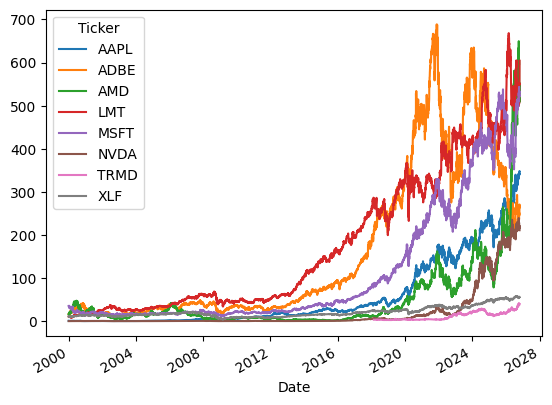
    


# Data Handling

[Back to Top](#Begin)

## Log Returns

Log returns are computed under the assumption of *continous time*. It comes from the inverse of the exponential function $e^t$

$\ln(e^t) = t$

Read: the natural-log of $e$ *to the something* is that something.

### Context

Where We Definied Returns Before;

$ r_t = $ return at time period t

$ p_t = $ asset price at time t

$ t = $ time-period eg. daily, weekly, monthly

Asset Return:

$$ r_t = \frac{p_t}{p_{t-1}} - 1$$

Then a series of successive returns of $n$ periods compounded is represented geometrically:

$$r_{\text{cumulative}} := (\prod_{i=1}^{n} 1 + r_i) - 1 = [(1+r_1) \cdot (1+r_2) \cdot (1+r_3) \dots (1+r_n)] - 1$$

This is a more expensive operation, adding 1s to each entry then performing $n$ multiplications.

## Natural Log to the Rescue

Some nice arithmetic properties of using ln() returns is that compounding is additive.

$$\ln\left( \frac{p_t}{p_{t-1}} \right) = \ln( p_t) - \ln( p_{t-1})$$

$$\ln\left( {p_t}\cdot{p_{t-1}} \right) = \ln( p_t) + \ln( p_{t-1})$$

### We Define Log-Returns:

$$r_t := \ln(p_t) - \ln(p_{t-1})$$

$$r_t := \ln(p_{\text{today} } ) - \ln(p_{\text{yesterday} })$$

## Calculation Method

We can apply NumPy's `ln()` function to an entire array of asset prices, then use pandas' `.shift()` method to subract a whole shifted array from the other.

Will look something like this:

```python
log_returns = np.log(data['Close']) - np.log(data['Close']).shift(1)
```

## Missing Data

At this point we will 'produce' a NaN value in our return calculation from our first date, we don't have a previous data point to compute a return from that point. So we'll just drop it. Other stock's will exhbit NaN's, say they weren't listed on an exchange at that point, so no data occurs for them.

## Interpretation

Working with log-returns is nice mathematically. But it will differ from the true return an investor will see if they have their money invested. For example, between 2018-02-26 and 2026-08-28.

### Example

#### AAPL's Average Daily Log-Return: 0.096%

#### AAPL's Average Daily Real Return: 0.123%


```python

```

# Task 1

# Compute Log-Returns


```python
log_returns = np.log(df['Close']) - np.log(df['Close']).shift(1)
log_returns
```


<div>
<style scoped>
    .dataframe tbody tr th:only-of-type {
        vertical-align: middle;
    }

    .dataframe tbody tr th {
        vertical-align: top;
    }

    .dataframe thead th {
        text-align: right;
    }
</style>
<table border="1" class="dataframe">
  <thead>
    <tr style="text-align: right;">
      <th>Ticker</th>
      <th>AAPL</th>
      <th>ADBE</th>
      <th>AMD</th>
      <th>LMT</th>
      <th>MSFT</th>
      <th>NVDA</th>
      <th>TRMD</th>
      <th>XLF</th>
    </tr>
    <tr>
      <th>Date</th>
      <th></th>
      <th></th>
      <th></th>
      <th></th>
      <th></th>
      <th></th>
      <th></th>
      <th></th>
    </tr>
  </thead>
  <tbody>
    <tr>
      <th>2000-01-03</th>
      <td>NaN</td>
      <td>NaN</td>
      <td>NaN</td>
      <td>NaN</td>
      <td>NaN</td>
      <td>NaN</td>
      <td>NaN</td>
      <td>NaN</td>
    </tr>
    <tr>
      <th>2000-01-04</th>
      <td>-0.088077</td>
      <td>-0.087618</td>
      <td>-0.058108</td>
      <td>0.033387</td>
      <td>-0.034364</td>
      <td>-0.027063</td>
      <td>NaN</td>
      <td>-0.044700</td>
    </tr>
    <tr>
      <th>2000-01-05</th>
      <td>0.014527</td>
      <td>0.019578</td>
      <td>0.025318</td>
      <td>0.005952</td>
      <td>0.010489</td>
      <td>-0.033476</td>
      <td>NaN</td>
      <td>-0.007888</td>
    </tr>
    <tr>
      <th>2000-01-06</th>
      <td>-0.090514</td>
      <td>0.008130</td>
      <td>0.064539</td>
      <td>0.014729</td>
      <td>-0.034072</td>
      <td>-0.067479</td>
      <td>NaN</td>
      <td>0.042980</td>
    </tr>
    <tr>
      <th>2000-01-07</th>
      <td>0.046281</td>
      <td>0.047440</td>
      <td>0.015504</td>
      <td>0.002919</td>
      <td>0.012983</td>
      <td>0.016562</td>
      <td>NaN</td>
      <td>0.016416</td>
    </tr>
    <tr>
      <th>...</th>
      <td>...</td>
      <td>...</td>
      <td>...</td>
      <td>...</td>
      <td>...</td>
      <td>...</td>
      <td>...</td>
      <td>...</td>
    </tr>
    <tr>
      <th>2026-10-19</th>
      <td>-0.001515</td>
      <td>0.007678</td>
      <td>0.017436</td>
      <td>-0.007016</td>
      <td>0.008414</td>
      <td>0.013729</td>
      <td>-0.015566</td>
      <td>-0.008320</td>
    </tr>
    <tr>
      <th>2026-10-20</th>
      <td>-0.010082</td>
      <td>0.038272</td>
      <td>-0.006171</td>
      <td>0.000875</td>
      <td>-0.003098</td>
      <td>-0.002860</td>
      <td>0.010579</td>
      <td>0.011916</td>
    </tr>
    <tr>
      <th>2026-10-21</th>
      <td>0.013139</td>
      <td>-0.006526</td>
      <td>0.033071</td>
      <td>0.005090</td>
      <td>0.002029</td>
      <td>0.025090</td>
      <td>0.034647</td>
      <td>0.005727</td>
    </tr>
    <tr>
      <th>2026-10-22</th>
      <td>0.012222</td>
      <td>0.058958</td>
      <td>-0.084508</td>
      <td>0.067310</td>
      <td>-0.022524</td>
      <td>-0.044966</td>
      <td>-0.021059</td>
      <td>0.010826</td>
    </tr>
    <tr>
      <th>2026-10-23</th>
      <td>-0.001408</td>
      <td>-0.025190</td>
      <td>0.017293</td>
      <td>0.023902</td>
      <td>0.006561</td>
      <td>-0.005908</td>
      <td>0.034689</td>
      <td>-0.013328</td>
    </tr>
  </tbody>
</table>
<p>6743 rows × 8 columns</p>
</div>


```python
log_returns.isna().sum(), log_returns[log_returns.index > '2018'].isna().sum()
```


    (Ticker
     AAPL       1
     ADBE       1
     AMD        1
     LMT        1
     MSFT       1
     NVDA       1
     TRMD    4565
     XLF        1
     dtype: int64,
     Ticker
     AAPL     0
     ADBE     0
     AMD      0
     LMT      0
     MSFT     0
     NVDA     0
     TRMD    37
     XLF      0
     dtype: int64)


## Note on NaN Handling

So far we can just ignore the NaNs. They aren't 'in the way' for calculating log-returns at this point. The 'sanity check' above tells us there isn't large holes in the data. I know that ticker TRMD wasn't listed until 2018 compared to our other tickers. So we are missing data for historical reasons. Plus we will have NaN from calculating returns.

If we know some caclulations will choose to 'ignore NaNs' or 'include NaNs', this is what looking up the code documentation is for.


```python
sum_stats = tools.summary_statistics_table(log_returns)

sum_stats
```


<div>
<style scoped>
    .dataframe tbody tr th:only-of-type {
        vertical-align: middle;
    }

    .dataframe tbody tr th {
        vertical-align: top;
    }

    .dataframe thead th {
        text-align: right;
    }
</style>
<table border="1" class="dataframe">
  <thead>
    <tr style="text-align: right;">
      <th></th>
      <th>AAPL</th>
      <th>ADBE</th>
      <th>AMD</th>
      <th>LMT</th>
      <th>MSFT</th>
      <th>NVDA</th>
      <th>TRMD</th>
      <th>XLF</th>
    </tr>
  </thead>
  <tbody>
    <tr>
      <th>Mean</th>
      <td>0.000894</td>
      <td>0.000413</td>
      <td>0.000520</td>
      <td>0.000604</td>
      <td>0.000400</td>
      <td>0.001152</td>
      <td>0.001143</td>
      <td>0.000241</td>
    </tr>
    <tr>
      <th>Median</th>
      <td>0.000951</td>
      <td>0.000747</td>
      <td>0.000000</td>
      <td>0.000575</td>
      <td>0.000381</td>
      <td>0.001378</td>
      <td>0.000000</td>
      <td>0.000616</td>
    </tr>
    <tr>
      <th>Standard-Deviation</th>
      <td>0.024859</td>
      <td>0.026656</td>
      <td>0.038870</td>
      <td>0.015886</td>
      <td>0.018993</td>
      <td>0.036740</td>
      <td>0.036179</td>
      <td>0.017757</td>
    </tr>
    <tr>
      <th>Skewness</th>
      <td>-3.917443</td>
      <td>-0.565404</td>
      <td>-0.085206</td>
      <td>-0.120945</td>
      <td>-0.090053</td>
      <td>-0.208016</td>
      <td>1.094497</td>
      <td>-0.159887</td>
    </tr>
    <tr>
      <th>Kurtosis</th>
      <td>115.268262</td>
      <td>12.353597</td>
      <td>8.187625</td>
      <td>9.033611</td>
      <td>9.478060</td>
      <td>13.031658</td>
      <td>28.882672</td>
      <td>15.469229</td>
    </tr>
    <tr>
      <th>Min</th>
      <td>-0.731247</td>
      <td>-0.353223</td>
      <td>-0.391595</td>
      <td>-0.136525</td>
      <td>-0.169576</td>
      <td>-0.434384</td>
      <td>-0.365860</td>
      <td>-0.182322</td>
    </tr>
    <tr>
      <th>Max</th>
      <td>0.142617</td>
      <td>0.214885</td>
      <td>0.420617</td>
      <td>0.137081</td>
      <td>0.178692</td>
      <td>0.353574</td>
      <td>0.497581</td>
      <td>0.152394</td>
    </tr>
  </tbody>
</table>
</div>


```python
np.exp(sum_stats.loc['Mean']) - 1
```


    AAPL    0.000895
    LMT     0.000604
    TRMD    0.001143
    Name: Mean, dtype: float64


```python
tools.return_histograms(log_returns)
```


    
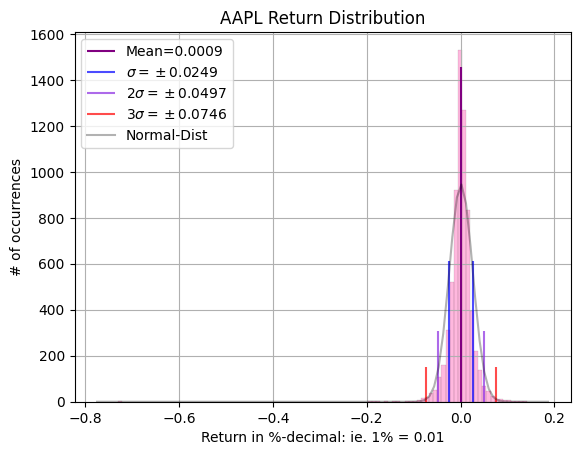
    


    
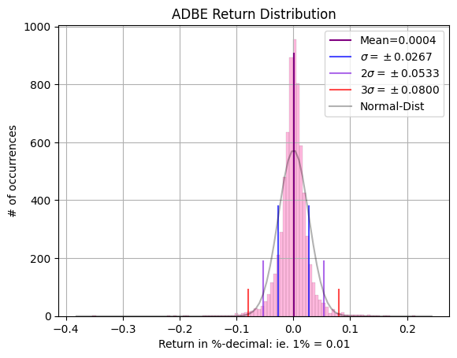
    


    

    


    
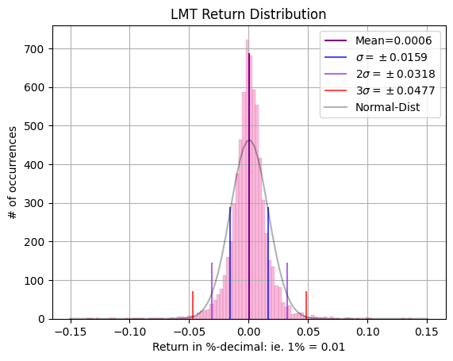
    


    

    


    
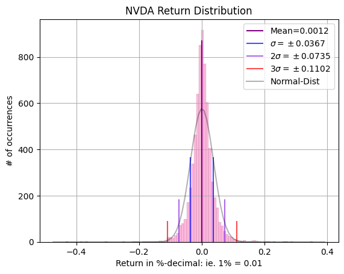
    


    
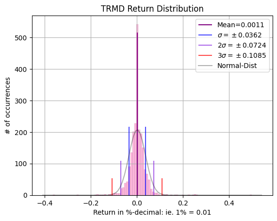
    


    
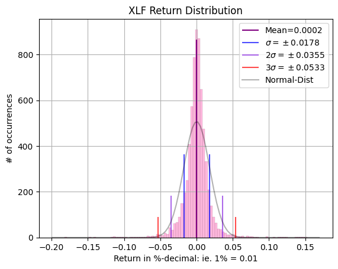
    


# Task 2

# Annual Volatility

Since log-returns are additive for compounding. We just need to group by year and sum for annualized returns across our time period.

Volatility I will elect to take rolling 90-day windows daily, then compute the average annually, then scale up to annualized by multiplying by $\sqrt{252}.$ Because volatility scales by $\sqrt{\text{time}}$.


```python
df_vol = log_returns.groupby(log_returns.index.year).std() * np.sqrt(252)
df_vol
```


<div>
<style scoped>
    .dataframe tbody tr th:only-of-type {
        vertical-align: middle;
    }

    .dataframe tbody tr th {
        vertical-align: top;
    }

    .dataframe thead th {
        text-align: right;
    }
</style>
<table border="1" class="dataframe">
  <thead>
    <tr style="text-align: right;">
      <th>Ticker</th>
      <th>AAPL</th>
      <th>ADBE</th>
      <th>AMD</th>
      <th>LMT</th>
      <th>MSFT</th>
      <th>NVDA</th>
      <th>TRMD</th>
      <th>XLF</th>
    </tr>
    <tr>
      <th>Date</th>
      <th></th>
      <th></th>
      <th></th>
      <th></th>
      <th></th>
      <th></th>
      <th></th>
      <th></th>
    </tr>
  </thead>
  <tbody>
    <tr>
      <th>2000</th>
      <td>1.013291</td>
      <td>0.887646</td>
      <td>0.854163</td>
      <td>0.444989</td>
      <td>0.568322</td>
      <td>1.186189</td>
      <td>NaN</td>
      <td>0.331983</td>
    </tr>
    <tr>
      <th>2001</th>
      <td>0.623043</td>
      <td>0.822725</td>
      <td>0.900010</td>
      <td>0.325891</td>
      <td>0.438939</td>
      <td>0.902450</td>
      <td>NaN</td>
      <td>0.252794</td>
    </tr>
    <tr>
      <th>2002</th>
      <td>0.489064</td>
      <td>0.692421</td>
      <td>0.952393</td>
      <td>0.367730</td>
      <td>0.427174</td>
      <td>0.981401</td>
      <td>NaN</td>
      <td>0.311292</td>
    </tr>
    <tr>
      <th>2003</th>
      <td>0.368728</td>
      <td>0.408799</td>
      <td>0.539770</td>
      <td>0.249781</td>
      <td>0.291202</td>
      <td>0.667258</td>
      <td>NaN</td>
      <td>0.197232</td>
    </tr>
    <tr>
      <th>2004</th>
      <td>0.396565</td>
      <td>0.298697</td>
      <td>0.461990</td>
      <td>0.174354</td>
      <td>0.170639</td>
      <td>0.634566</td>
      <td>NaN</td>
      <td>0.122632</td>
    </tr>
    <tr>
      <th>2005</th>
      <td>0.387664</td>
      <td>0.328790</td>
      <td>0.476979</td>
      <td>0.152657</td>
      <td>0.143365</td>
      <td>0.365248</td>
      <td>NaN</td>
      <td>0.118995</td>
    </tr>
    <tr>
      <th>2006</th>
      <td>0.381431</td>
      <td>0.325087</td>
      <td>0.516663</td>
      <td>0.161712</td>
      <td>0.210594</td>
      <td>0.475017</td>
      <td>NaN</td>
      <td>0.116614</td>
    </tr>
    <tr>
      <th>2007</th>
      <td>0.375966</td>
      <td>0.243814</td>
      <td>0.375896</td>
      <td>0.226210</td>
      <td>0.227153</td>
      <td>0.463281</td>
      <td>NaN</td>
      <td>0.240719</td>
    </tr>
    <tr>
      <th>2008</th>
      <td>0.587321</td>
      <td>0.557204</td>
      <td>0.854952</td>
      <td>0.392372</td>
      <td>0.480072</td>
      <td>0.860922</td>
      <td>NaN</td>
      <td>0.715477</td>
    </tr>
    <tr>
      <th>2009</th>
      <td>0.337117</td>
      <td>0.461454</td>
      <td>0.747912</td>
      <td>0.337798</td>
      <td>0.372304</td>
      <td>0.590599</td>
      <td>NaN</td>
      <td>0.642080</td>
    </tr>
    <tr>
      <th>2010</th>
      <td>0.266856</td>
      <td>0.387890</td>
      <td>0.452773</td>
      <td>0.184714</td>
      <td>0.219773</td>
      <td>0.433601</td>
      <td>NaN</td>
      <td>0.254628</td>
    </tr>
    <tr>
      <th>2011</th>
      <td>0.262498</td>
      <td>0.337804</td>
      <td>0.554851</td>
      <td>0.217149</td>
      <td>0.234736</td>
      <td>0.572293</td>
      <td>NaN</td>
      <td>0.334177</td>
    </tr>
    <tr>
      <th>2012</th>
      <td>0.293047</td>
      <td>0.233939</td>
      <td>0.543149</td>
      <td>0.146997</td>
      <td>0.207030</td>
      <td>0.318067</td>
      <td>NaN</td>
      <td>0.175048</td>
    </tr>
    <tr>
      <th>2013</th>
      <td>0.289052</td>
      <td>0.246303</td>
      <td>0.510984</td>
      <td>0.163837</td>
      <td>0.251409</td>
      <td>0.215777</td>
      <td>NaN</td>
      <td>0.143168</td>
    </tr>
    <tr>
      <th>2014</th>
      <td>0.216682</td>
      <td>0.255751</td>
      <td>0.415048</td>
      <td>0.171165</td>
      <td>0.189913</td>
      <td>0.251187</td>
      <td>NaN</td>
      <td>0.128606</td>
    </tr>
    <tr>
      <th>2015</th>
      <td>0.267491</td>
      <td>0.235262</td>
      <td>0.553386</td>
      <td>0.167759</td>
      <td>0.280299</td>
      <td>0.338892</td>
      <td>NaN</td>
      <td>0.176189</td>
    </tr>
    <tr>
      <th>2016</th>
      <td>0.233725</td>
      <td>0.247617</td>
      <td>0.787210</td>
      <td>0.168902</td>
      <td>0.227149</td>
      <td>0.444309</td>
      <td>NaN</td>
      <td>0.187039</td>
    </tr>
    <tr>
      <th>2017</th>
      <td>0.175283</td>
      <td>0.214611</td>
      <td>0.595090</td>
      <td>0.111503</td>
      <td>0.147292</td>
      <td>0.399248</td>
      <td>NaN</td>
      <td>0.130699</td>
    </tr>
    <tr>
      <th>2018</th>
      <td>0.287745</td>
      <td>0.354572</td>
      <td>0.631398</td>
      <td>0.240515</td>
      <td>0.282352</td>
      <td>0.503993</td>
      <td>0.551523</td>
      <td>0.196180</td>
    </tr>
    <tr>
      <th>2019</th>
      <td>0.262970</td>
      <td>0.238078</td>
      <td>0.526421</td>
      <td>0.164202</td>
      <td>0.198203</td>
      <td>0.407911</td>
      <td>0.682979</td>
      <td>0.155148</td>
    </tr>
    <tr>
      <th>2020</th>
      <td>0.466763</td>
      <td>0.478132</td>
      <td>0.608085</td>
      <td>0.413867</td>
      <td>0.439912</td>
      <td>0.581173</td>
      <td>0.953601</td>
      <td>0.455230</td>
    </tr>
    <tr>
      <th>2021</th>
      <td>0.250920</td>
      <td>0.296812</td>
      <td>0.423363</td>
      <td>0.202473</td>
      <td>0.210195</td>
      <td>0.446810</td>
      <td>0.458495</td>
      <td>0.188600</td>
    </tr>
    <tr>
      <th>2022</th>
      <td>0.356347</td>
      <td>0.457323</td>
      <td>0.613248</td>
      <td>0.263290</td>
      <td>0.353215</td>
      <td>0.631647</td>
      <td>0.602670</td>
      <td>0.244616</td>
    </tr>
    <tr>
      <th>2023</th>
      <td>0.202813</td>
      <td>0.317865</td>
      <td>0.464017</td>
      <td>0.179892</td>
      <td>0.249601</td>
      <td>0.467705</td>
      <td>0.454074</td>
      <td>0.162461</td>
    </tr>
    <tr>
      <th>2024</th>
      <td>0.225953</td>
      <td>0.372241</td>
      <td>0.481054</td>
      <td>0.170214</td>
      <td>0.200676</td>
      <td>0.520646</td>
      <td>0.336824</td>
      <td>0.140974</td>
    </tr>
    <tr>
      <th>2025</th>
      <td>0.322133</td>
      <td>0.311297</td>
      <td>0.588068</td>
      <td>0.268496</td>
      <td>0.240342</td>
      <td>0.498238</td>
      <td>0.425621</td>
      <td>0.191217</td>
    </tr>
    <tr>
      <th>2026</th>
      <td>0.259569</td>
      <td>0.444757</td>
      <td>0.705254</td>
      <td>0.310494</td>
      <td>0.348479</td>
      <td>0.375230</td>
      <td>0.419793</td>
      <td>0.149908</td>
    </tr>
  </tbody>
</table>
</div>


```python
df_yearly = df['Close'].groupby(df.index.year)
```


```python
yearly_returns = {}

for year in df_yearly:
    yr = year[0]
    df1 = year[1]
    

    lg_rtn = np.log(df1) - np.log(df1).shift(1)

    yearly_returns.update({yr: lg_rtn.sum()})

yearly_return_summary = pd.DataFrame(yearly_returns).T
yearly_return_summary = np.exp(yearly_return_summary) - 1


```

# Annual Return Summary

Below is a table of annual returns.

## Notable Years:

- 2000 was the Dot-Com era crash that led to large negative returns in technology companies like Apple.
- 2008 was the Great Financial Crisis, so we see stocks with a large negative return that year
- 2020, although Intra-Year 2020 saw a massive crash in Q1, the stock market recovered and rallied as a whole throughout the year as liquidity was pumped in the system and new market participants took discretionary money on stock trading, (ie. Robinhood stock-pickers).
- 2022 we can see the 'Mini Bear Market' of interest rate hiking following COVID


Calculation:

To take log-returns back into percentage returns, we need to exponentiate them.

$$r_{\text{Compounded}} = e^{r_{\text{log}} } - 1$$


```python
yearly_return_summary
```


<div>
<style scoped>
    .dataframe tbody tr th:only-of-type {
        vertical-align: middle;
    }

    .dataframe tbody tr th {
        vertical-align: top;
    }

    .dataframe thead th {
        text-align: right;
    }
</style>
<table border="1" class="dataframe">
  <thead>
    <tr style="text-align: right;">
      <th>Ticker</th>
      <th>AAPL</th>
      <th>ADBE</th>
      <th>AMD</th>
      <th>LMT</th>
      <th>MSFT</th>
      <th>NVDA</th>
      <th>TRMD</th>
      <th>XLF</th>
    </tr>
  </thead>
  <tbody>
    <tr>
      <th>2000</th>
      <td>-0.734227</td>
      <td>0.776116</td>
      <td>-0.108871</td>
      <td>0.707128</td>
      <td>-0.627882</td>
      <td>0.399862</td>
      <td>0.000000</td>
      <td>0.307565</td>
    </tr>
    <tr>
      <th>2001</th>
      <td>0.472267</td>
      <td>-0.334549</td>
      <td>0.103304</td>
      <td>0.383753</td>
      <td>0.527377</td>
      <td>3.469297</td>
      <td>0.000000</td>
      <td>-0.068147</td>
    </tr>
    <tr>
      <th>2002</th>
      <td>-0.384978</td>
      <td>-0.219961</td>
      <td>-0.605857</td>
      <td>0.258458</td>
      <td>-0.228819</td>
      <td>-0.828974</td>
      <td>0.000000</td>
      <td>-0.146386</td>
    </tr>
    <tr>
      <th>2003</th>
      <td>0.443917</td>
      <td>0.528984</td>
      <td>1.125535</td>
      <td>-0.115966</td>
      <td>0.027999</td>
      <td>0.884650</td>
      <td>0.000000</td>
      <td>0.259132</td>
    </tr>
    <tr>
      <th>2004</th>
      <td>2.026314</td>
      <td>0.606887</td>
      <td>0.481830</td>
      <td>0.115084</td>
      <td>0.088101</td>
      <td>0.020797</td>
      <td>0.000000</td>
      <td>0.110176</td>
    </tr>
    <tr>
      <th>2005</th>
      <td>1.271764</td>
      <td>0.198484</td>
      <td>0.429239</td>
      <td>0.193944</td>
      <td>-0.010124</td>
      <td>0.550468</td>
      <td>0.000000</td>
      <td>0.065885</td>
    </tr>
    <tr>
      <th>2006</th>
      <td>0.134983</td>
      <td>0.067497</td>
      <td>-0.371914</td>
      <td>0.471730</td>
      <td>0.128613</td>
      <td>0.936682</td>
      <td>0.000000</td>
      <td>0.169318</td>
    </tr>
    <tr>
      <th>2007</th>
      <td>1.363723</td>
      <td>0.070391</td>
      <td>-0.615779</td>
      <td>0.161517</td>
      <td>0.208429</td>
      <td>0.414358</td>
      <td>0.000000</td>
      <td>-0.195698</td>
    </tr>
    <tr>
      <th>2008</th>
      <td>-0.561948</td>
      <td>-0.489571</td>
      <td>-0.697479</td>
      <td>-0.186290</td>
      <td>-0.437856</td>
      <td>-0.755529</td>
      <td>0.000000</td>
      <td>-0.539958</td>
    </tr>
    <tr>
      <th>2009</th>
      <td>1.322094</td>
      <td>0.597741</td>
      <td>3.067227</td>
      <td>-0.091734</td>
      <td>0.534423</td>
      <td>1.144661</td>
      <td>0.000000</td>
      <td>0.162653</td>
    </tr>
    <tr>
      <th>2010</th>
      <td>0.507219</td>
      <td>-0.170127</td>
      <td>-0.156701</td>
      <td>-0.057144</td>
      <td>-0.079441</td>
      <td>-0.167117</td>
      <td>0.000000</td>
      <td>0.096949</td>
    </tr>
    <tr>
      <th>2011</th>
      <td>0.228874</td>
      <td>-0.096516</td>
      <td>-0.362456</td>
      <td>0.207734</td>
      <td>-0.047546</td>
      <td>-0.123894</td>
      <td>0.000000</td>
      <td>-0.189217</td>
    </tr>
    <tr>
      <th>2012</th>
      <td>0.305586</td>
      <td>0.318866</td>
      <td>-0.562044</td>
      <td>0.178842</td>
      <td>0.025976</td>
      <td>-0.121147</td>
      <td>0.000000</td>
      <td>0.251425</td>
    </tr>
    <tr>
      <th>2013</th>
      <td>0.047508</td>
      <td>0.561815</td>
      <td>0.529644</td>
      <td>0.663476</td>
      <td>0.395438</td>
      <td>0.286952</td>
      <td>0.000000</td>
      <td>0.316712</td>
    </tr>
    <tr>
      <th>2014</th>
      <td>0.426284</td>
      <td>0.226176</td>
      <td>-0.324051</td>
      <td>0.361329</td>
      <td>0.284229</td>
      <td>0.286810</td>
      <td>0.000000</td>
      <td>0.156886</td>
    </tr>
    <tr>
      <th>2015</th>
      <td>-0.020822</td>
      <td>0.298590</td>
      <td>0.074906</td>
      <td>0.157398</td>
      <td>0.218785</td>
      <td>0.664514</td>
      <td>0.000000</td>
      <td>-0.017701</td>
    </tr>
    <tr>
      <th>2016</th>
      <td>0.123843</td>
      <td>0.119387</td>
      <td>3.093863</td>
      <td>0.205591</td>
      <td>0.165057</td>
      <td>2.329197</td>
      <td>0.000000</td>
      <td>0.248248</td>
    </tr>
    <tr>
      <th>2017</th>
      <td>0.480425</td>
      <td>0.693467</td>
      <td>-0.100612</td>
      <td>0.300130</td>
      <td>0.397411</td>
      <td>0.904264</td>
      <td>0.000000</td>
      <td>0.206506</td>
    </tr>
    <tr>
      <th>2018</th>
      <td>-0.070543</td>
      <td>0.273157</td>
      <td>0.681239</td>
      <td>-0.156867</td>
      <td>0.202191</td>
      <td>-0.328455</td>
      <td>-0.225921</td>
      <td>-0.130832</td>
    </tr>
    <tr>
      <th>2019</th>
      <td>0.887425</td>
      <td>0.468629</td>
      <td>1.435475</td>
      <td>0.508813</td>
      <td>0.582592</td>
      <td>0.734099</td>
      <td>0.821177</td>
      <td>0.307760</td>
    </tr>
    <tr>
      <th>2020</th>
      <td>0.782400</td>
      <td>0.495440</td>
      <td>0.867821</td>
      <td>-0.088323</td>
      <td>0.399428</td>
      <td>1.180241</td>
      <td>-0.244669</td>
      <td>-0.026848</td>
    </tr>
    <tr>
      <th>2021</th>
      <td>0.380610</td>
      <td>0.168377</td>
      <td>0.559046</td>
      <td>0.062464</td>
      <td>0.557899</td>
      <td>1.244762</td>
      <td>0.084469</td>
      <td>0.366520</td>
    </tr>
    <tr>
      <th>2022</th>
      <td>-0.281995</td>
      <td>-0.403707</td>
      <td>-0.568890</td>
      <td>0.408920</td>
      <td>-0.276872</td>
      <td>-0.514370</td>
      <td>2.869618</td>
      <td>-0.116722</td>
    </tr>
    <tr>
      <th>2023</th>
      <td>0.547982</td>
      <td>0.770747</td>
      <td>1.302562</td>
      <td>-0.025131</td>
      <td>0.583498</td>
      <td>2.460983</td>
      <td>0.404513</td>
      <td>0.116393</td>
    </tr>
    <tr>
      <th>2024</th>
      <td>0.355563</td>
      <td>-0.233403</td>
      <td>-0.128374</td>
      <td>0.093269</td>
      <td>0.145016</td>
      <td>1.788741</td>
      <td>-0.260754</td>
      <td>0.300030</td>
    </tr>
    <tr>
      <th>2025</th>
      <td>0.119908</td>
      <td>-0.206372</td>
      <td>0.775346</td>
      <td>0.032509</td>
      <td>0.163905</td>
      <td>0.348789</td>
      <td>0.050371</td>
      <td>0.151884</td>
    </tr>
    <tr>
      <th>2026</th>
      <td>0.286582</td>
      <td>-0.208461</td>
      <td>1.312570</td>
      <td>0.237495</td>
      <td>0.116077</td>
      <td>0.119691</td>
      <td>1.270783</td>
      <td>0.030106</td>
    </tr>
  </tbody>
</table>
</div>


# Task 3

[Back to Top](#Begin)

# Data Visualization

# Data Visualization


```python
log_returns[log_returns.index > '03-01-2018'].cumsum().plot(title='Cumulative Return 2018-2026')
```


    <Axes: title={'center': 'Cumulative Return 2018-2026'}, xlabel='Date'>


    
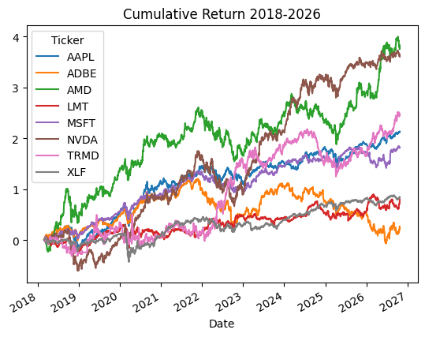
    


```python
log_returns.rolling(window=90).std().plot(title='Rolling 90-Day Volatility')
```


    <Axes: title={'center': 'Rolling 90-Day Volatility'}, xlabel='Date'>


    
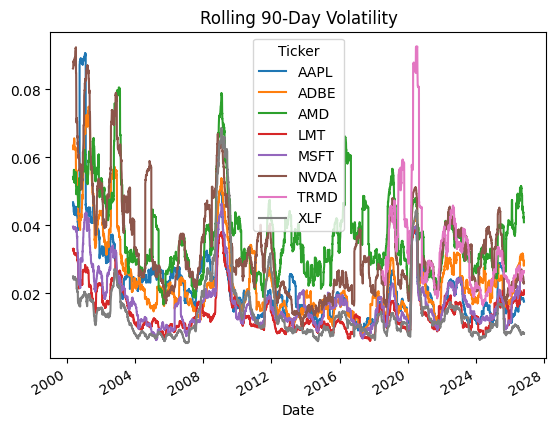
    


# Correlation Matrix


```python
log_returns.corr()
```


<div>
<style scoped>
    .dataframe tbody tr th:only-of-type {
        vertical-align: middle;
    }

    .dataframe tbody tr th {
        vertical-align: top;
    }

    .dataframe thead th {
        text-align: right;
    }
</style>
<table border="1" class="dataframe">
  <thead>
    <tr style="text-align: right;">
      <th>Ticker</th>
      <th>AAPL</th>
      <th>ADBE</th>
      <th>AMD</th>
      <th>LMT</th>
      <th>MSFT</th>
      <th>NVDA</th>
      <th>TRMD</th>
      <th>XLF</th>
    </tr>
    <tr>
      <th>Ticker</th>
      <th></th>
      <th></th>
      <th></th>
      <th></th>
      <th></th>
      <th></th>
      <th></th>
      <th></th>
    </tr>
  </thead>
  <tbody>
    <tr>
      <th>AAPL</th>
      <td>1.000000</td>
      <td>0.418488</td>
      <td>0.356143</td>
      <td>0.179366</td>
      <td>0.456748</td>
      <td>0.407097</td>
      <td>0.099042</td>
      <td>0.388956</td>
    </tr>
    <tr>
      <th>ADBE</th>
      <td>0.418488</td>
      <td>1.000000</td>
      <td>0.365070</td>
      <td>0.214215</td>
      <td>0.538793</td>
      <td>0.441653</td>
      <td>0.049759</td>
      <td>0.435302</td>
    </tr>
    <tr>
      <th>AMD</th>
      <td>0.356143</td>
      <td>0.365070</td>
      <td>1.000000</td>
      <td>0.150427</td>
      <td>0.397393</td>
      <td>0.497858</td>
      <td>0.083286</td>
      <td>0.369273</td>
    </tr>
    <tr>
      <th>LMT</th>
      <td>0.179366</td>
      <td>0.214215</td>
      <td>0.150427</td>
      <td>1.000000</td>
      <td>0.238703</td>
      <td>0.136005</td>
      <td>0.066637</td>
      <td>0.392232</td>
    </tr>
    <tr>
      <th>MSFT</th>
      <td>0.456748</td>
      <td>0.538793</td>
      <td>0.397393</td>
      <td>0.238703</td>
      <td>1.000000</td>
      <td>0.479276</td>
      <td>0.068947</td>
      <td>0.489246</td>
    </tr>
    <tr>
      <th>NVDA</th>
      <td>0.407097</td>
      <td>0.441653</td>
      <td>0.497858</td>
      <td>0.136005</td>
      <td>0.479276</td>
      <td>1.000000</td>
      <td>0.091890</td>
      <td>0.362183</td>
    </tr>
    <tr>
      <th>TRMD</th>
      <td>0.099042</td>
      <td>0.049759</td>
      <td>0.083286</td>
      <td>0.066637</td>
      <td>0.068947</td>
      <td>0.091890</td>
      <td>1.000000</td>
      <td>0.121257</td>
    </tr>
    <tr>
      <th>XLF</th>
      <td>0.388956</td>
      <td>0.435302</td>
      <td>0.369273</td>
      <td>0.392232</td>
      <td>0.489246</td>
      <td>0.362183</td>
      <td>0.121257</td>
      <td>1.000000</td>
    </tr>
  </tbody>
</table>
</div>


```python
yearly_corr = log_returns.groupby(log_returns.index.to_period("Q")).corr()

yearly_corr.xs('AAPL', level=1).plot(title='Correlation with AAPL')
```


    <Axes: title={'center': 'Correlation with AAPL'}, xlabel='Date'>


    
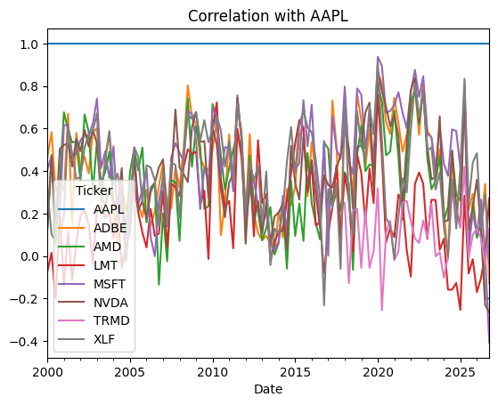
    


# Task 4
[Back To Top](#Begin)

## Written Assesment

Presented here is a dynamic and interactive data analysis document. The user can build a portfolio of tickers to perfrom analysis and run the coding cells producing analysis. It all works sequentially, so one can perform another analysis by just going back to the top and choosing a different date range and set of tickers.

Comparing 2-3 stocks, intially I chose Apple, Lockheed Martin, and TORM ( A shipping tanker company). These different tickers exhibit different return and volatility characteristics. You can see that Lockheed Martin exhibits the lowest volatility, as a large stable company in the defense sector, this makes sense. Compared to Apple in the technology sector, we can see Apple's higher-cumulative return matches their higher volatility. If you scan the correlation matrix you can see companies like Apple, Microsoft, Nividia exhibit high correlation overall on a large time-period, which makes sense as they are all technology companies. All these companies exhibit a lower correlation with Lockheed Martin, an aerospace and defense industrial conglomerate. This makes sense, as this sector is more defensive, in the financial sense of the word 'defensive', then technology growth stocks.

What is interesting is quickly in the last few years other blue-chip technology companies have started to show negative correlation with Apple. This seems to be an second-order effect of how the competition surrounding Artificial Intelligence is impacting tech-sector stocks. This sort of observation would warrant a further analysis.

From a macroeconomic perspective you can see the impact of large exogenous events on all of these stocks. Most notably 2000 era Dot-Com crash in Apple. Volatility spikes and negative returns in 2007,2008 due to the Great Financial Crisis. You can also note 2020 COVID-era crash and subsequent rally, followed by 2022 interest-rate hiking adding volatility. More recently you can see 2025 "Liberation Day" volatility spikes from President Trump's aggressive tarrif policy announcements. As an tanker company that deals in oil-markets, you can see Torm's stock rally during 2022 Russian oil embargo, and sinking of oil vessels in Red Sea and 2026 war on Iran. TRMD's exposure to these regional crises has been limited, while their company has benefited from the higher-price point demanded in international markets for shipping tankers.


```python
corr_analysis = log_returns[log_returns.index > '2020']
corr_analysis = corr_analysis.groupby(corr_analysis.index.to_period("Q")).corr()

corr_analysis.xs('AAPL', level=1).plot(title='Correlation with AAPL')
```


    <Axes: title={'center': 'Correlation with AAPL'}, xlabel='Date'>


    
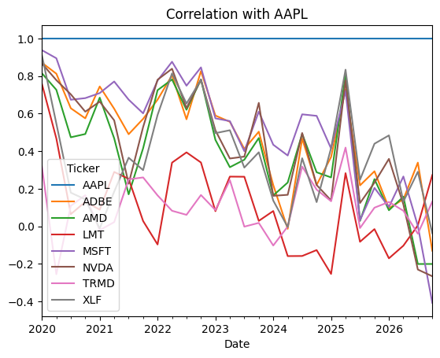
    


```python

```
